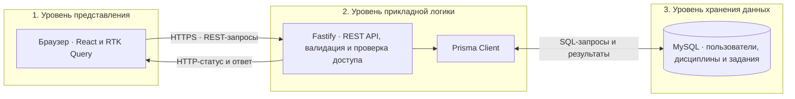

# Архитектура SemesterFlow

Документ описывает устройство приложения на основе [требований к SemesterFlow](requirements.md) и [правил разработки](../AGENTS.md).

## 1. Общая архитектура

SemesterFlow использует клиент-серверную трёхуровневую архитектуру. Уровень представления работает в браузере, прикладная логика выполняется в одном серверном приложении Fastify, а данные хранятся в MySQL. Frontend и backend размещаются в отдельных каталогах одного Git-репозитория. Prisma работает внутри backend и связывает прикладную логику с базой данных.



## 2. Клиентская часть

Клиент отображает формы регистрации и входа, личную панель со сроками, списки дисциплин и заданий. React Router управляет переходами между страницами, включая три защищённых маршрута `/dashboard`, `/subjects` и `/tasks`.

Клиент проверяет поля формы перед отправкой, передаёт поисковый запрос и параметры фильтрации серверу, отображает загрузку, результаты и ошибки. RTK Query выполняет HTTP-запросы и обновляет данные после изменений. Состояние полей формы хранится в компонентах, а состояние аутентификации на время работы страницы — в памяти через Redux Toolkit.

## 3. Серверная часть

Fastify принимает запросы по HTTP, проверяет входные данные и выполняет операции с дисциплинами и заданиями. Для защищённых маршрутов общий обработчик проверяет JWT. Обработчики предметных маршрутов применяют правила доступа с учётом текущего пользователя и обращаются к MySQL через Prisma.

Маршруты сгруппированы по назначению. В каждом модуле находятся обработчики и схемы валидации соответствующих запросов. Личная панель использует тот же ресурс заданий с параметрами отбора и сортировки по дедлайну.

## 4. Уровень хранения данных

MySQL хранит учётные записи, дисциплины и задания. У одной учётной записи может быть несколько дисциплин, у каждой дисциплины — несколько заданий. Дисциплина ссылается на владельца, а задание — на дисциплину. Владелец задания определяется через эту связь.

Внешние ключи обеспечивают целостность связей. Предлагаемое правило удаления — дисциплину можно удалить после удаления или переноса её заданий. Пока задания связаны с дисциплиной, база отклоняет удаление, а API возвращает ошибку конфликта. Prisma описывает модели и связи, а история миграций позволяет воспроизвести схему базы данных.

## 5. Выбор технологического стека

| Инструмент | Зачем используется |
| --- | --- |
| React | Позволяет разделить интерфейс на переиспользуемые компоненты, например формы и списки. |
| Vite | Запускает сервер разработки с обновлением страницы при изменениях и собирает клиент для развёртывания. |
| React Router | Связывает адреса страниц с компонентами и управляет переходами внутри приложения. |
| Redux Toolkit | Даёт единое хранилище для состояния аутентификации, которое нужно нескольким страницам. |
| RTK Query | Выполняет запросы к API, предоставляет состояния загрузки и ошибки, кэширует ответы и позволяет обновить их после изменений. |
| CSS | Позволяет оформить компоненты и адаптировать формы и списки к размерам экрана. |
| Node.js | Выполняет серверный JavaScript и позволяет использовать один язык на клиенте и сервере. |
| Fastify | Предоставляет HTTP-маршрутизацию, валидацию по схемам и общие обработчики для защищённых маршрутов. |
| MySQL | Хранит связанные данные и обеспечивает их целостность с помощью внешних ключей и ограничений. |
| Prisma и миграции | Prisma Client предоставляет операции с моделями, а миграции фиксируют и воспроизводят изменения схемы MySQL. |
| JWT Bearer | Позволяет серверу определить пользователя по подписанному токену, который клиент передаёт с защищённым запросом. |
| bcrypt | Хеширует пароли с солью и регулируемой стоимостью вычисления, чтобы усложнить подбор пароля при утечке базы. |

## 6. Предлагаемая структура каталогов

```text
SemesterFlow/
├── docs/                    Документация проекта
├── frontend/
│   └── src/
│       ├── app/             Настройка маршрутов и хранилища
│       ├── pages/           Вход, регистрация, панель, дисциплины и задания
│       ├── components/      Общие элементы интерфейса и формы
│       ├── api/             Описание запросов RTK Query
│       └── styles/          Общие стили
└── backend/
    ├── src/
    │   ├── routes/          Маршруты, схемы валидации и обработчики
    │   └── plugins/         Подключение Prisma и проверка JWT
    └── prisma/
        ├── schema.prisma    Модели базы данных
        └── migrations/      История изменений схемы
```

## 7. Взаимодействие через REST API

Клиент отправляет запросы к ресурсам под префиксом `/api`. Данные запросов и ответов передаются в JSON. Для дисциплин и заданий используются одинаковые правила работы с коллекциями и отдельными записями.

| Запрос | Назначение |
| --- | --- |
| `POST /api/auth/register`, `POST /api/auth/login` | Создать учётную запись или получить JWT после входа. |
| `GET /api/subjects`, `GET /api/tasks` | Получить список своих записей. Для заданий параметры запроса задают поиск по названию, дисциплину, диапазон дедлайнов, статус и сортировку. |
| `GET /api/subjects/{id}`, `GET /api/tasks/{id}` | Получить одну свою запись. |
| `POST /api/subjects`, `POST /api/tasks` | Создать запись. |
| `PATCH /api/subjects/{id}`, `PATCH /api/tasks/{id}` | Изменить переданные поля записи. |
| `DELETE /api/subjects/{id}`, `DELETE /api/tasks/{id}` | Удалить запись. |

API возвращает `200` при успешном чтении или изменении, `201` при создании и `204` при удалении. Ошибки возвращаются с подходящим HTTP-статусом и понятным сообщением без внутренних деталей сервера.

## 8. Аутентификация и хранение паролей

1. При регистрации сервер проверяет входные данные, хеширует пароль с помощью bcrypt и сохраняет хеш в MySQL.
2. При входе сервер находит учётную запись и проверяет пароль по сохранённому хешу. При успешной проверке сервер подписывает JWT с идентификатором пользователя и сроком действия.
3. RTK Query добавляет к защищённым запросам заголовок `Authorization: Bearer <token>`. Сервер проверяет подпись и срок действия токена, затем извлекает идентификатор пользователя. Недействительный или отсутствующий токен приводит к ответу `401 Unauthorized`.
4. Клиент хранит токен в памяти. После обновления страницы или истечения срока действия токена пользователь входит снова. При выходе или ответе `401` на защищённый запрос клиент очищает токен и кэш личных данных.

Пароли и хеши исключаются из ответов сервера. Ключ подписи JWT и параметры подключения к базе передаются через переменные окружения. В развёрнутом приложении браузер обращается к API по HTTPS.

## 9. Разграничение доступа к данным

Сервер определяет текущего пользователя по проверенному JWT. При создании дисциплины сервер сам назначает ей владельца. Для заданий сервер проверяет, что выбранная дисциплина принадлежит этому пользователю, в том числе при переносе задания в другую дисциплину.

Запросы к MySQL учитывают принадлежность данных при чтении, поиске, изменении и удалении. Для действий с конкретной записью запрос ограничивается её идентификатором и владельцем. Если запись отсутствует или принадлежит другому пользователю, API возвращает `404 Not Found`. Это правило действует и при прямом запросе к серверу по идентификатору.

## 10. Пример создания учебного задания

1. Студент выбирает дисциплину, вводит название, дедлайн и статус. Оценку можно добавить позже. Клиент проверяет поля и отправляет `POST /api/tasks` с данными формы и JWT.
2. Fastify проверяет токен и валидирует данные запроса. При неверном токене сервер возвращает `401`, при некорректных полях — `400 Bad Request`.
3. Обработчик через Prisma ищет дисциплину по её идентификатору и идентификатору пользователя из токена. Если подходящей дисциплины нет, сервер возвращает `404`, а задание не создаётся.
4. Prisma сохраняет задание в MySQL со ссылкой на найденную дисциплину. MySQL проверяет внешний ключ, после успешной записи сервер возвращает `201 Created` и данные задания.
5. RTK Query обновляет данные списка заданий и личной панели. Интерфейс показывает новое задание в тех списках, условиям которых оно соответствует.
